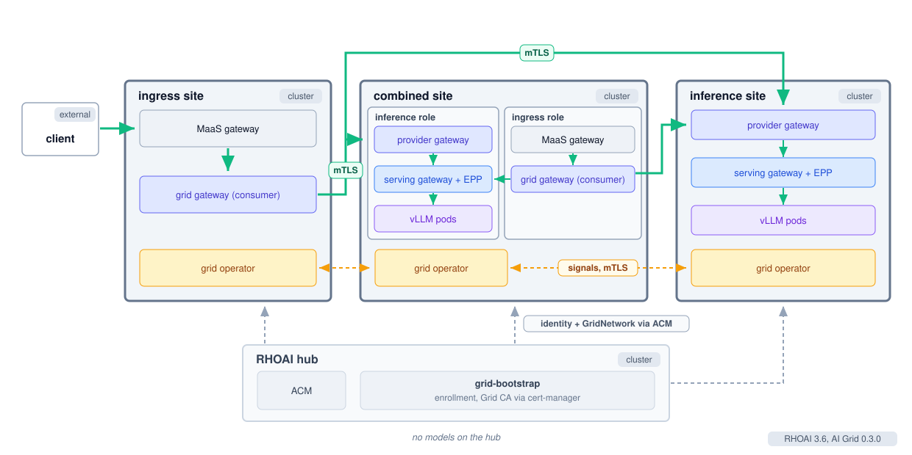
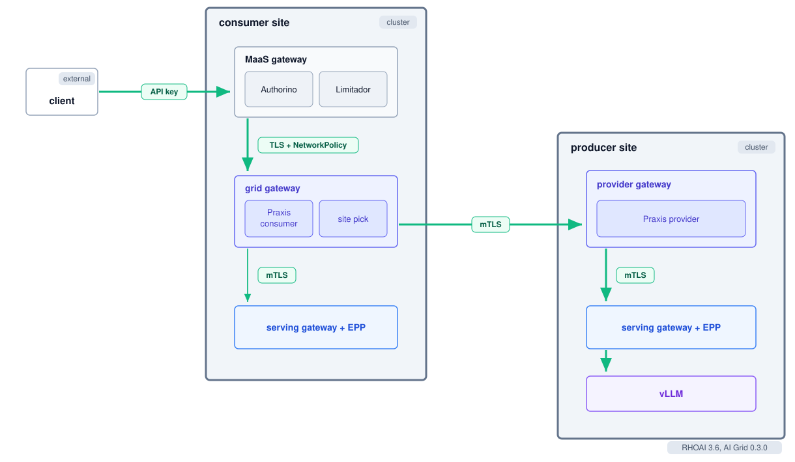
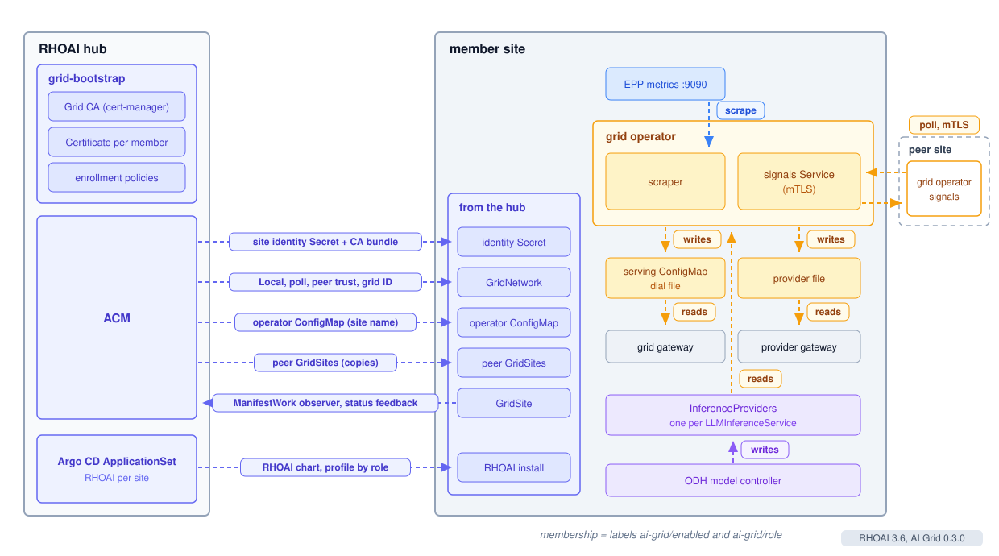

# AI Grid RHOAI 3.6

| Author | Status | Versions |
|---|---|---|
| Sam Batschelet | Draft | RHOAI 3.6, AI Grid 0.3.0 |

## Summary

AI Grid lets Red Hat OpenShift AI (RHOAI) serve models across one or more clusters as
a single service. A client uses one entry point, and the grid routes each request to
a site that serves the model and has capacity. A hub cluster running Red Hat
Advanced Cluster Management (ACM) enrolls the member sites under one certificate
authority and delivers each site's identity and membership. Each site publishes
its live load to its peers. Models as a Service (MaaS) continues to own the
caller's identity, entitlement, and token budget.

Telco is a representative use case. It runs GPU capacity at many sites, from
regional data centers to the edge, and offers it to its tenants as one governed
service. Each request stays inside the region it is allowed in and is metered
to the tenant that sent it.

This document describes the grid as it ships in RHOAI 3.6, with the focus on
the Praxis grid gateways and their integration with MaaS.

## Topology

A grid is a hub plus member sites. The hub runs ACM and the grid enrollment chart in external mode, called
grid-bootstrap. It holds the Grid certificate authority (CA) through
cert-manager. It never runs the enrollment service.

Each member site runs RHOAI with the AI Grid component enabled. Its
ManagedCluster name is its site identity, and labels on the ManagedCluster
select it and its profile. A site takes one of three profiles.

| Profile | Runs | Purpose |
|---|---|---|
| Ingress | MaaS gateway and a consumer grid gateway. No models. | Entry point for MaaS clients. |
| Inference | KServe LLMInferenceService with the llm-d router, and a provider grid gateway. No MaaS. | Serves models to the grid. Callers reach them through another site's MaaS. |
| Combined | Both of the above. | Entry point and models on one cluster. |

Every member runs the grid operator. The RHOAI AI gateway operator deploys it
when the DataScienceCluster sets aiGrid to Managed. The operator image, both
gateway images and the enrollment image come from the RHOAI payload, and the
grid CRDs come from the AI gateway operator's manifests.

## Request path

| Hop | Security |
|---|---|
| Client to MaaS gateway | API key |
| MaaS gateway to grid gateway | TLS, and a NetworkPolicy that admits only the MaaS gateway |
| Grid gateway to the local serving gateway | TLS and a token |
| Grid gateway to a peer's provider gateway | Mutual TLS |
| Provider gateway to its serving gateway | TLS and a token |

MaaS authenticates the consumer once. The grid never re-authenticates the
caller. It trusts MaaS admission and secures the site-to-site hop with its own
identity.

### Consumer side

The MaaS gateway runs Red Hat Connectivity Link: Envoy with Authorino, and
Limitador driven through the MaaS payload-processing ext_proc. For a grid-served
model, the MaaS tenant declares an ExternalModel whose ExternalProvider points at
the grid gateway Service, so MaaS dials the grid gateway in cluster.

The grid gateway is Praxis in the consumer role, with authentication mode none
because MaaS already authenticated the caller. It routes every request by site:

1. Read the dial file the operator writes and keep the sites that serve the model.
2. Apply the sovereignty and geo fence.
3. Apply prefix affinity, so a conversation's follow-up turns return to the site
   that holds its KV cache prefix.
4. Pick by live load. Queue depth is the primary signal and KV cache
   utilization the baseline, because KV utilization stops changing near
   saturation while the queue keeps growing.
5. If every eligible site is past full, shed with 429 and Retry-After, because
   OpenAI clients back off and retry on 429.

The gateway stamps x-grid-site and x-grid-backend on the response. It dials a
local model through the RHOAI serving gateway with a base path, so the llm-d
endpoint picker (EPP) still picks the pod. It dials a remote model at the peer
site's provider gateway.

### Provider side

Every site that serves models runs the provider gateway, Praxis in the provider
role. An OpenShift Route with TLS passthrough exposes it at site.grid.internal,
the name on the site's leaf certificate, so the peer's client certificate
reaches the listener intact. The gateway admits peers listed in the operator's
provider file by the identity in their certificate and forwards to the local model through the
serving gateway.

### Two policy planes

The split follows two planes. The consumer plane, MaaS, decides who the caller
is, what they may call and what they may spend. The federation plane, the grid,
decides where an admitted request goes and whether the target may serve it.
Today the handoff between them is the in-cluster dial. A signed wristband
carrying the admitted identity and claims is the designed handoff for when the
planes run as separate hops.

## Control plane

The hub enrolls each member and replicates identity, membership, and peer
GridSites to it through ACM, as the next section lists. The product shape has no
SWIM gossip. Sites poll each other for signals.

InferenceProviders declare the models. On an inference site the ODH model
controller publishes one per LLMInferenceService.

The grid operator on each site does the signal work outside the request path:

- Scrapes each local InferenceProvider's EPP metrics for average KV cache
  utilization, average queue size and ready endpoints.
- Serves these signals on an mTLS signals endpoint and polls its peers'
  signals the same way.
- Writes a serving ConfigMap with the dial file the consumer gateway reads, and
  a provider file the provider gateway reads.

The gateways read only these files on the request path. They never call the
Kubernetes API or a peer to make a routing decision.

## Object replication with ACM

The control plane figure shows these flows. Two labels on the ManagedCluster set
membership: ai-grid/enabled=true makes it a grid member, and ai-grid/role
(ingress, inference, or combined) selects what RHOAI installs. The provider
console's Add to AI Grid action sets both. A Placement on those labels drives
every row below.

| Object | Direction | Carried by | On withdrawal |
|---|---|---|---|
| Site identity Secret and Grid CA bundle | Hub to member | Policy copying the issued Secret of the hub's per-member Certificate, signed by the Grid CA. The CA signing key never leaves the hub. | Retained. Renewal stops, and the certificate is not revoked. |
| GridNetwork | Hub to member | Policy, after the identity Secret, the CA bundle and the Grid CRDs exist. Local membership, poll transport, peer trust, the member's consumer gateway reference, and the grid ID from an immutable state ConfigMap on the hub. | Retained. Leaving the network is an explicit membership change. |
| Operator ConfigMap | Hub to member | Policy. Site-only, carries the site name. | Removed with the peer records. |
| Peer GridSites | Hub to member | Policy writing every other member's GridSite with mustonlyhave, so the hub's view wins. | The policy removes the remote copies. |
| Signals Route and own GridSite | Hub to member, model-serving sites only | Policy creating a passthrough Route for the signals Service and writing the GridSite from the admitted Route hosts of the provider gateway and the signals Service. | The Route is removed. The own GridSite is retained. |
| GridSite observer | Member to hub | ManifestWork installing a read-only observer. Its status feedback gives the hub the member's GridSite, the input to the peer GridSites row. | The ManifestWork is removed and the hub stops reading the member's GridSite. The observer's permissions on the member are left in place. |
| RHOAI product chart | Hub to member | Argo CD ApplicationSet joining the Placement decisions with the cluster Secret's role label, rendering the profile for the role. | Removing the role stops managing the site's RHOAI. The site stays a member until ai-grid/enabled goes too. |

Everything a member needs arrives by policy from the hub, and the hub reads
members without a member ever dialing it. No member reaches another except
through the two gateways and the signals Service over grid mTLS.

## Observability

Each gateway serves a TLS metrics listener on port 9443 that authenticates
scrapers with TokenReview. The chart renders the ServiceMonitor with a bearer
token and relabels the gateway's candidate label to backend.

The RHOAI collector scrapes it, and ACM observability federates site metrics to
the hub. The AI Grid routing dashboard ships in the product chart on every
gateway site and shows in the RHOAI console. It shows why each request went
where: outcome, selection path, per-site load and capacity, and reading
freshness.

Each site's collector forwards MaaS usage records to a LokiStack on the hub.

## Versions

As of 2026-11-11, Grid v0.3.0 runs across the operator, the gateways and
enrollment. The rhai-on-openshift-chart repository vendors the charts, and the CRDs
follow the AI gateway operator's manifest bump.

## Known limits

- A site that serves no models has no provider gateway address, so its GridSite reports Available False, although routing from it works.
- The gateway exposes no readiness endpoint reachable from outside its pod.
- A site belongs to one grid network.
- Session affinity LRU is currently bound to a single grid gateway.
