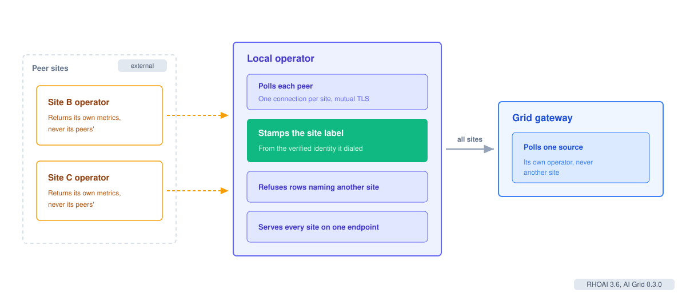
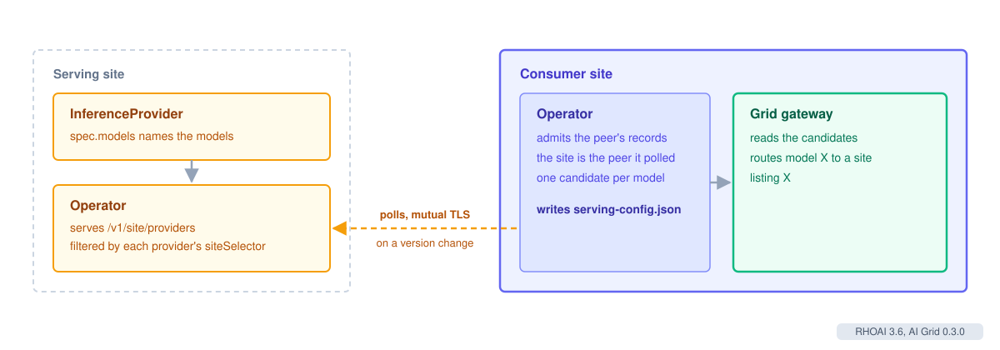

# AI Grid Signals Contract

| Author | Status | Versions |
|---|---|---|
| Sam Batschelet | Draft | RHOAI 3.6, AI Grid 0.3.0 |

## Summary

Each grid site publishes the live load of its model providers, and every other
site reads it to route. This document describes that contract. It covers who
produces the signals, the endpoint, who may read what, how a sample keeps an
honest origin and age, and which series the gateway uses. It also covers the
model catalog, which travels beside the signals.

How the gateway turns these signals into a routing decision is in
[AI Grid Site Selection](../site-selection/README.md).

## Producers and readers

The grid operator on each site is the only producer. It scrapes the EPP of each
local InferenceProvider and keeps what it parsed. It polls every peer operator for
that peer's own providers, one mutual TLS connection per site.

The consumer grid gateway reads one source: its own operator. It never dials a
peer or an EPP for signals, so a provider's credentials stay on its own site.

## The endpoint

The operator serves one path, /v1/site/signals, over mutual TLS under the Grid
certificate authority. Peers and the local gateway use the same path.

- The body is Prometheus text exposition. A target parameter selects one
  provider, and collect[] selects series by name.
- Every sample carries a trailing timestamp. The response's Date header comes
  from the same clock reading, so a reader takes a sample's age as Date minus its
  stamp. No reader compares its own clock against another site's.
- The Age header bounds the oldest value in the response.
- A held value expires when its writer stops, rather than being marked stale. A
  missing series means a stopped writer.
- Only gauges are republished. Counters and histograms stay on the site that
  scraped them.

## Who sees what

The caller's certificate decides the view, never the path or a parameter.

| Caller | Sees |
|---|---|
| The site's own gateway, presenting the site's own certificate | Every site: its own providers, the relayed peer samples, and when each peer was last polled. |
| A peer whose certificate matches this site's GridSite record for it | This site's own providers only, never another site's. A provider whose accessPolicy.siteSelector excludes the peer is withheld. |
| Any other caller | Nothing. |

Reading a provider's load is no wider a right than routing to it, so the same
siteSelector bounds both.

## Attribution

The operator stamps two labels on every sample it publishes: grid_site and
grid_provider. A provider that set either label itself keeps its value under an
exported_ name, so a provider cannot claim to be another site.

When the operator ingests a peer's response, the dialed peer's verified
identity is the origin. A sample with no site label is attributed to that peer.
A sample naming another site is refused, not re-attributed.

## Models

Load and models travel separately. The model catalog has its own path,
/v1/site/providers, on the same mutual TLS listener as the signals.

1. Each InferenceProvider names its models in spec.models.
2. The operator serves its providers as JSON records on /v1/site/providers. Each
   record names the provider, its routing cluster, its models, its capacityWeight
   and its phase. A peer sees only the providers whose accessPolicy.siteSelector
   it satisfies, the same rule as the signals.
3. Every signals answer carries an x-grid-providers-version header. A peer
   re-reads the catalog only when that version changes.
4. The consumer operator admits the records. The site comes from the peer it
   polled, never from the body. It refuses a record that claims one of its own
   clusters or another peer's, and a body over 256 records or 256 KiB. After a
   refused or failed read it keeps the last catalog it accepted.
5. The operator writes one routing candidate per model into the gateway's
   serving config: the model, the site, the cluster, whether it is fresh,
   and its weight.

A peer's models stay in the catalog while its GridSite names it. When a peer goes
silent, its signals age out and site selection routes around it, but its models
remain listed.

In AI Grid 0.3.0 only models named in spec.models reach a peer. A provider that
uses spec.modelDiscovery publishes a catalog record with no models, so peers do
not route to its discovered models.

## Series

The operator relays the llm-d EPP pool gauges. The gateway reads these.

| Series | Use |
|---|---|
| llm_d_epp_flow_control_pool_saturation | Saturation, when the EPP publishes it. |
| llm_d_epp_average_kv_cache_utilization | KV share, for derived saturation. |
| llm_d_epp_std_dev_kv_cache_utilization | KV spread across the pool's units. |
| llm_d_epp_average_queue_size | Requests waiting per endpoint. |
| llm_d_epp_average_running_requests | Requests running per endpoint. |
| llm_d_epp_ready_endpoints | Ready endpoints, the site's capacity. |
| llm_d_epp_flow_control_queue_size | Work held by EPP flow control. |
| llm_d_epp_per_endpoint_queue_size | Work waiting at each endpoint. |

Where the current EPP name is absent, the gateway reads the earlier
inference_pool series for queue size, ready pods and KV utilization. On an EPP
serving more than one pool, a series with no inference_pool label is the total
across pools, so it counts for none of them.

## Timing

| Step | Default |
|---|---|
| Peer poll round | Every 5 seconds, with a 10 second budget per round. |
| Gateway poll of its own operator | Every second. |
| Freshness window | 24 seconds. |

A local reading reaches the gateway in about 2 seconds, and a remote one in 2
to 10 seconds. A site with no reading inside the freshness window is silent.
The gateway treats a silent site as unmeasured, not idle, and routes around it
while any live site remains.

The operator also tells its own gateway when each peer was last included in a
completed poll round. The gateway judges a peer's silence against those rounds,
not its own clock. A peer's copy of these rows is dropped on receipt and never
served to a peer.
