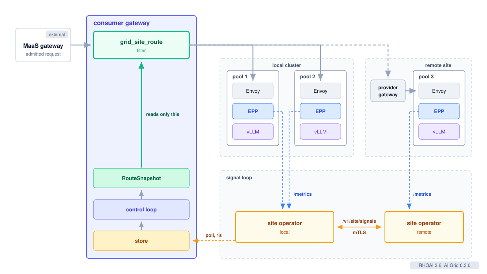
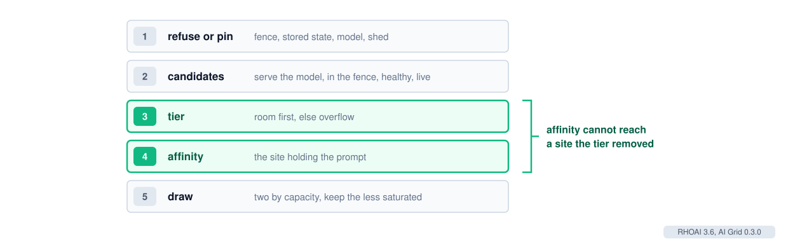

# AI Grid Smart Routing

| Author | Status | Versions |
|---|---|---|
| Sam Batschelet | Draft | RHOAI 3.6, AI Grid 0.3.0 |

## Summary

The consumer grid gateway picks a site, or a pool on its own cluster, for every
request with the grid_site_route filter. The EPP behind that pool still picks the
pod. This document describes how the filter decides. It covers the order of its
checks, how it reads load and capacity, prefix affinity and shedding, and the
settings and metrics an operator tunes with.

The architecture around it, including where the signals come from, is in
[AI Grid RHOAI 3.6](../rhoai/README.md).

## Placement

A request reads one route snapshot. A control loop in the gateway builds that
snapshot from the signals it polls from its own operator every second. The
request path never reads the signal store, the Kubernetes API or a peer.

A site's reading is seconds old when the gateway uses it. A local reading is
about 2 seconds old, and a remote one 2 to 10 seconds. It waits for the EPP
scrape, the peer poll round and the gateway's own poll. A reading older than
the 24 second freshness window makes the site silent: unmeasured, not idle.

## Decision order

1. Refuse or pin. A request outside the sovereignty fence, with no model, or for a
   shed model is answered here with 403, 400 or 429. A request naming a stored
   response or conversation goes to the site that stored it.
2. Candidates. The sites that serve the model, pass the fence, and are healthy
   and live. A site with no reading inside the 24 second freshness window is
   silent and steps aside while any live site remains.
3. Tier. Sites with room come first. With no room anywhere, the overflow tier
   keeps the sites that are not full.
4. Affinity. Inside the tier, prefer the site holding the prompt's prefix. It
   cannot bring back a site the tier removed.
5. Draw. Pick two sites by capacity and keep the less saturated one.

An unknown model gets 404, and a request no site can take gets 503 with
Retry-After. A routed response names the chosen site and backend in x-grid-site
and x-grid-backend.

## Load and capacity

For an llm-d site, saturation is the EPP's own flow-control saturation when the
EPP publishes it. Otherwise the gateway derives it as the larger of the KV cache
share over 0.8 and the requests waiting per endpoint over 5. Both are the llm-d
utilization detector's defaults. The gateway smooths saturation with a moving
average that steps once per new sample.

A site's capacity is its ready endpoints times the capacityWeight its
InferenceProvider declares. Routing cannot move either number, so a site never
earns a larger share by the traffic it was sent. A provider that publishes no KV
share, such as an external one, has no such reading. For that case the gateway
learns a ceiling from what the site has carried.

## Admission

A site has room below full saturation. It is full only when saturation reaches 1
with work waiting, held for 5 seconds. A full KV cache with an empty queue keeps
its room. A shed model routes again once a site has had room for 2 seconds.

## The draw

The draw uses no random number. A turn counter mixed with per-replica salts picks
the two candidates, so replicas do not move together. Between two sites the
share stays between 0.1 and 0.9. An emptier, larger site gets more requests, and
the other still gets at least one in ten.

Every gateway reads the same seconds-old load. Least loaded first would send them
all to the site that looked idle. Two choices spreads them, and three choices is
worse than two under stale load.

## Prefix affinity

Each gateway replica remembers which site it sent a prompt's prefix to, keyed by
hashes of the prompt text with no tokenizer. A 2xx response confirms the record,
a 5xx evicts it, and any other response forgets an unconfirmed record.

A site holding the prompt is preferred when the match is at least 32 blocks or
0.8 of the prompt. The queue gate prices the cached prefix as prefill time saved,
at 10,000 tokens a second, and each queued request as 2 seconds of wait. When the
holder's extra queue costs more than the prefix saves, affinity lets the request
go elsewhere. 2% of requests skip affinity, so a second site learns a shared
prefix.

## Shedding

Shedding is off by default. When on, a model sheds once every healthy, live site
that serves it is full, and stays shed until one has room. An unmeasured healthy
site blocks shedding and takes the overflow. Keep shedding off where EPP flow
control is on, so one overload is not shed twice.

## Settings

| Setting | Default | Meaning |
|---|---|---|
| shedding | false | Answer 429 when every site for a model is full. |
| smoothing | 0.3 | Weight of the newest saturation sample. |
| full_after_ms | 5000 | Time at full with work waiting before a site counts as full. |
| room_after_ms | 2000 | Time with room before a shed model routes again. |
| queue_full | 1.0 | Queued requests per unit that count as a backlog. |
| ceiling_floor | 8 | Lowest learned ceiling, for a provider with no KV share. |
| explore_floor | 0.25 | Share of the largest capacity an unproven site keeps. |
| prefix_affinity.enabled | true | Prefer the site holding the prompt. |
| prefix_affinity.threshold | 0.8 | Share of the prompt a site must hold. |
| prefix_affinity.exploration | 0.02 | Share of requests that skip affinity. |
| prefix_affinity.capacity | 16384 | Prefix entries per backend per replica. |
| prefix_affinity.ttl_secs | 600 | Lifetime of a confirmed prefix. |

## Metrics

| Metric | Healthy | Act when |
|---|---|---|
| grid_route_decisions_total | Routed outcomes dominate. | Refusals rise: read the reason label. |
| grid_route_selections_total | The two-choice path dominates. | The capacity-only path means no room or unknown saturation. |
| grid_route_site_rho | Reaches 1 as a queue forms. | It swings: lower smoothing. It lags: raise it. |
| grid_route_shedding | Engages as queues form. | It engages late: shorten full_after_ms. It flaps: lengthen room_after_ms. |
| grid_route_prefix_affinity_total | The sticky share holds. | Sticky falls and no-match rises: raise the affinity capacity. |
| grid_route_site_silent | 0 | 1: check the operator's peer polls. |
| grid_route_fenced_total | Matches the traffic that names a zone. | Refusals in enforce mode: check the zone header. |
